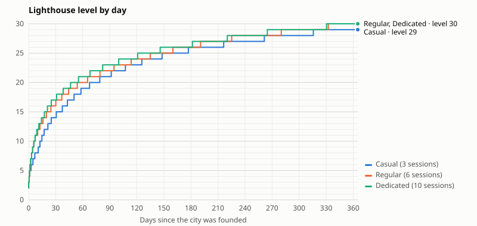

# Balance

What the rules of `shared/` give over a year of play (365 days), measured by `npm run balance` (`tools/balance/`, week 6, task 5). The tables are written by the script; `npm test` fails when they no longer match the rules. The CSV of every day is `docs/balance/days.csv`. The script changes no value: the rules it plays are those of `shared/`, rebalanced on 18 October by the owner's decisions (options I and J below, then the gentler curve after Lighthouse 15; `docs/decisions.md`).

## How the players play

Three players, with the same choices; only the number of sessions a day differs:

| Profile | Sessions | Times |
| --- | --- | --- |
| Casual | 3 | 8:00, 13:00, 21:00 |
| Regular | 6 | 7:00, 10:00, 13:00, 16:00, 19:00, 22:00 |
| Dedicated | 10 | every 1 h 40 from 7:00 to 22:00 |

The city is founded on day 1 at 8:00, in a first session. A session is instant: the player starts everything the rules allow, then leaves; between sessions, the rules run alone (`advance`). In each session, in this order:

1. **Builders:** the Lighthouse first; otherwise the lowest building (Refinery, Lumberyard, Fishery, Shelters, Barracks, Observatory, Harbor, Infirmary).
2. **Observatory:** the next research of a fixed list (Refining, Saws, Nets, Warehouses, then the sea, then war).
3. **Barracks:** promotions once the Veteran Doctrine is researched, else a batch of soldiers, the three types in turn.
4. **Infirmary:** heals the wounded.
5. **Sea:** the lowest pirate camp with all the troops if the odds are "easy"; every other fleet salvages the nearest wreck.
6. **Captains:** unlock and add stars as soon as there are shards; the rarest, then highest level, leads; a Logbook while 100 Pearls are left after it.
7. **Rafts:** a building on an empty raft (Greenhouse, Smokehouse, Watchtower, two of each), else the lowest raft building upgraded, else a new raft.

**The reserve:** while the Lighthouse waits, every other spending leaves untouched the cost of its next level, up to what the storage holds (no one can save more); while the Lighthouse is being built, or once it is at level 30, nothing is kept. A first try without this reserve for the other buildings gave a player who never researched nor trained in 60 days: they spent all the wood on buildings first.

**The Mist** (week 7, task 1) is played: three a day on the city's clock, the order to stoke left on, as for a new city. **Not modeled:** the Leviathan, objectives and daily tasks (week 7, tasks 3 and 4), other players, the daily recruitment, Fish Shoals and Wooded Isles (fleets cannot go there yet).

## Results

<!-- balance:generated:start (npm run balance) -->

### Milestones (days after the city is founded)

| Profile | Lighthouse 5 | Lighthouse 10 | Lighthouse 15 | Lighthouse 20 | Lighthouse 25 | Lighthouse 30 | Refinery 2 | Barracks 1 | First camp beaten |
| --- | --- | --- | --- | --- | --- | --- | --- | --- | --- |
| Casual (3 sessions) | day 1.1 | day 7.8 | day 27.5 | day 66.0 | day 154.0 | day 385.4 | day 4.0 | day 0.0 | day 2.0 |
| Regular (6 sessions) | day 1.1 | day 5.8 | day 19.7 | day 54.0 | day 134.9 | day 332.4 | day 2.4 | day 0.0 | day 2.0 |
| Dedicated (10 sessions) | day 1.1 | day 5.7 | day 17.5 | day 46.5 | day 121.0 | day 330.4 | day 1.5 | day 0.0 | day 1.1 |

### Day 30

| Profile | Lighthouse | Power | Oil | Fish | Wood | Storage | Troops + veterans | Captains (lead, level, stars) | Techs | Rafts | Camps beaten |
| --- | --- | --- | --- | --- | --- | --- | --- | --- | --- | --- | --- |
| Casual (3 sessions) | 15 | 61,074 | 32,391 | 28,957 | 27,548 | 56,550 | 479 | 6 (mira, 8, 19★) | 27 | 6 | 36 |
| Regular (6 sessions) | 16 | 89,212 | 66,615 | 30,781 | 28,309 | 65,975 | 288 | 6 (mira, 15, 30★) | 28 | 7 | 66 |
| Dedicated (10 sessions) | 17 | 99,633 | 87,748 | 15,535 | 34,187 | 85,768 | 481 | 6 (mira, 20, 30★) | 28 | 7 | 97 |

### Day 90

| Profile | Lighthouse | Power | Oil | Fish | Wood | Storage | Troops + veterans | Captains (lead, level, stars) | Techs | Rafts | Camps beaten |
| --- | --- | --- | --- | --- | --- | --- | --- | --- | --- | --- | --- |
| Casual (3 sessions) | 21 | 137,380 | 149,835 | 190,827 | 66,768 | 244,978 | 385 | 6 (mira, 20, 30★) | 28 | 7 | 84 |
| Regular (6 sessions) | 22 | 152,029 | 318,474 | 150,607 | 104,316 | 318,474 | 525 | 6 (mira, 20, 30★) | 28 | 7 | 122 |
| Dedicated (10 sessions) | 23 | 158,541 | 381,275 | 62,521 | 82,317 | 414,011 | 831 | 6 (mira, 20, 30★) | 28 | 7 | 211 |

### Day 365

| Profile | Lighthouse | Power | Oil | Fish | Wood | Storage | Troops + veterans | Captains (lead, level, stars) | Techs | Rafts | Camps beaten |
| --- | --- | --- | --- | --- | --- | --- | --- | --- | --- | --- | --- |
| Casual (3 sessions) | 29 | 233,798 | 283,674 | 1,044,464 | 521,338 | 1,998,372 | 641 | 6 (mira, 20, 30★) | 28 | 7 | 179 |
| Regular (6 sessions) | 30 | 252,261 | 2,592,437 | 458,152 | 808,144 | 2,597,893 | 789 | 6 (mira, 20, 30★) | 28 | 7 | 256 |
| Dedicated (10 sessions) | 30 | 254,579 | 2,600,293 | 393,789 | 1,116,593 | 2,597,893 | 1,176 | 6 (mira, 20, 30★) | 28 | 7 | 357 |

### Waiting and blocks

| Profile | Builder hours free a day (days 1–30) | (days 31–90) | (days 91–365) | Sessions with a builder free and nothing to start | Sessions with nothing at all | Blocked by (sessions) | Hours full: oil, fish, wood |
| --- | --- | --- | --- | --- | --- | --- | --- |
| Casual (3 sessions) | 37.5 | 17.3 | 15.1 | 403 of 1095 (37 %) | 0 | oil 6, wood 397 | 0, 0, 0 |
| Regular (6 sessions) | 25.0 | 11.5 | 7.5 | 481 of 2190 (22 %) | 0 | wood 481 | 1357, 0, 0 |
| Dedicated (10 sessions) | 18.6 | 6.7 | 9.4 | 796 of 3650 (22 %) | 1 | fish 1, wood 795 | 4251, 0, 0 |

### The storage wall

| Profile | Lighthouse level | Next level costs | Storage holds | Days at the wall | Got past it |
| --- | --- | --- | --- | --- | --- |
| Casual (3 sessions) | not reached | | | | |
| Regular (6 sessions) | not reached | | | | |
| Dedicated (10 sessions) | not reached | | | | |

### The storage and the Lighthouse, level by level (the rules alone)

| Lighthouse level | Storage | With Sealed Warehouses 3 | Next level: wood | Next level: build time |
| --- | --- | --- | --- | --- |
| 5 | 14,000 | 20,300 | 970 | 0.2 days |
| 10 | 26,500 | 38,425 | 5,210 | 0.8 days |
| 15 | 39,000 | 56,550 | 28,000 | 3.4 days |
| 20 | 129,963 | 188,446 | 103,970 | 8.4 days |
| 25 | 482,538 | 699,679 | 386,030 | 20.9 days |
| 29 | 1,378,188 | 1,998,372 | 1,102,550 | 43.4 days |
| 30 | 1,791,650 | 2,597,893 | – | max level |

<!-- balance:generated:end -->

## What it shows

> Written before the Mist (week 7, task 1). The tables above include it; this text is brought up to date in week 7, task 5. The Mist alone moves the casual player's Lighthouse 10 from day 7.6 to 12.6 and 15 from 26.0 to 30.7 (oil runs short); the regular and dedicated players move by 0 to 10 %. With stoking at 1.5 times the oil instead of 2.2 (the owner's decision of 18 October), the casual player's Lighthouse 10 is back on day 7.8 and 15 on day 27.5.

### 1. The pace: in line with the genre up to Lighthouse 15, Lighthouse 30 in about a year

- **Lighthouse 10** comes on day 5.7 (dedicated), 5.8 (regular) and 7.6 (casual); **Lighthouse 15** on day 17.5, 19.7 and 26.0. In Whiteout Survival, an active player reaches the equivalent of level 15 in one to two weeks: the dedicated player is a few days behind it, the casual one about two weeks.
- After 15, each level costs 1.3 times and takes 1.2 times the one before: **Lighthouse 20** on day 45.2 to 63.0, **25** on day 119.4 to 152.4, **30** on day 321.4 (regular), 325.8 (dedicated) and 371.4 (casual, level 29 on day 365).
- The longest build is the last one, 29 to 30: 43.4 days. Build time leads after 15: the regular and the dedicated player reach each level within a few days of each other.

### 2. No storage wall

- The storage always holds 1.25 times the wood of the Lighthouse's next level: 39,000 at Lighthouse 15, 129,963 at 20, 1,791,650 at 30 (2,597,893 with Sealed Warehouses 3, the most the game holds). No one meets a wall in a year, and the Lighthouse never needs a camp's loot.
- The other buildings keep their ×1.6 a level: even at Lighthouse 30 with Sealed Warehouses 3, upgrading them costs more than the storage from level 21 (Barracks, Harbor, Observatory) to 23 (Fishery, Lumberyard). The players of the simulation are at level 14 to 18 after a year (open question in `docs/decisions.md`).

### 3. What blocks

- **Wood, in about one session in five:** a builder is left free with nothing to start in 19 % (regular, all for wood) and 20 % (dedicated: wood 740 times, fish once) of the sessions in a year. The casual player is blocked in 31 % of them: wood 240 times, and oil 101 times, nearly all in the second half of the year, when the Lighthouse's last levels ask more oil than three sessions a day bring from the wrecks.
- Oil is plentiful for the others: it stays full 1,331 hours (regular) and 4,201 hours (dedicated) in a year, 651 and 1,103 in the first 90 days. A wreck no longer brings oil past the storage. Giving it a use is an open question for week 7.

### 4. Early game

- Lighthouse 5 comes on day 1.1 for everyone; Refinery 2 on day 1.5 (dedicated) to 4.0 (casual); the first camp beaten on day 1.1 to 2.0.

## After Lighthouse 15 (applied: ×1.3 and ×1.2)

Measured on `90cdb9c`, before the owner chose the gentler curve (×1.3 in cost, ×1.2 in time a level from level 16 on). Measured over 1,500 days on temporary copies of the rules, the Lighthouse's cost and time changing from its level 15 to 16 on (the levels up to 15 unchanged); "–" is not reached in 1,500 days. "Build time 15 → 30" adds up the Lighthouse's own build times alone.

| After 15: cost / time a level | Build time 15 → 30 | Lighthouse 20 (casual / regular / dedicated) | Lighthouse 25 | Lighthouse 30 | Level on day 365 | Storage at Lighthouse 30 (without Warehouses) |
| --- | --- | --- | --- | --- | --- | --- |
| ×1.4 / ×1.35 (option I, before) | 861 days | 72 / 62 / 56 | 250 / 227 / 215 | 971 / 937 / 917 | 26 / 26 / 26 | 5,445,325 |
| ×1.45 / ×1.4 (steeper) | 1,306 days | 78 / 66 / 61 | 314 / 282 / 272 | 1,515 / 1,382 / 1,436 | 25 / 25 / 25 | 9,217,713 |
| ×1.5 / ×1.45 (steeper still) | 1,971 days | 83 / 72 / 63 | 405 / 373 / 356 | – / – / – | 24 / 24 / 25 | 15,327,525 |
| ×1.6 / ×1.55 (about the prototype's) | 4,396 days | 95 / 84 / 75 | 619 / 600 / 579 | – / – / – | 23 / 23 / 23 | 40,355,500 |
| ×1.4 / ×1.2 | 244 days | 67 / 56 / 50 | 198 / 165 / 155 | 687 / 561 / 548 | 27 / 28 / 28 | 5,445,325 |
| ×1.35 / ×1.25 | 371 days | 66 / 56 / 50 | 176 / 154 / 152 | 549 / 488 / 488 | 28 / 28 / 28 | 3,155,800 |
| **×1.3 / ×1.2 (applied)** | 244 days | 63 / 53 / 45 | 152 / 123 / 119 | 371 / 321 / 326 | 29 / 30 / 30 | 1,791,650 |
| ×1.3 / ×1.15 | 161 days | 62 / 50 / 44 | 139 / 111 / 108 | 353 / 286 / 285 | 30 / 30 / 30 | 1,791,650 |

Option I's curve made Lighthouse 30 a goal of about two and a half years, set by build time (the level 29 to 30 alone took 226 days); a steeper one pushed it past four years and the storage into the tens of millions. The owner chose the gentler curve: Lighthouse 30 in about a year, with levels added later rather than the pace slowed after the fact. (The measures above ran before a fix of the simulator: at level 30, it kept a reserve for a level 31; the milestones did not change.)

## Measured options (applied: I and J)

Measured on `7f6cf68`, before the rebalance, over 60 days: each option was applied to a temporary copy of the rules, played by the three profiles, then removed. Days are after the city is founded; "–" is not reached in 60 days. The owner chose I and J on 18 October; the tables above are the rules with both.

| Option | Lighthouse 10 (casual / regular / dedicated) | Lighthouse 15 | Days at the storage wall (regular / dedicated) | Regular player's sessions blocked by wood |
| --- | --- | --- | --- | --- |
| Before (the prototype's values) | 31.5 / 22.1 / 21.2 | – / – / – | 15.0 / 16.8, never past | 76 % of sessions |
| A. Storage at least 1.25 × the Lighthouse's next wood cost | 31.5 / 22.1 / 21.2 | – / – / – | 0 / 0 (Lighthouse 13 on day 57.2, dedicated) | 70 % |
| B. Lighthouse cost ×1.5 a level instead of ×1.62 | 25.5 / 17.1 / 15.4 | – / – / 75.3 | 0 / 0 in 60 days; the wall comes back at Lighthouse 13 to 15 (without or with Sealed Warehouses) | 46 % |
| C. Lighthouse build time ×1.4 a level instead of ×1.55 | 28.8 / 21.7 / 20.7 | – / – / – | 27.2 / 31.1, from Lighthouse 11, never past | 92 % |
| D. Twice the wood (Lumberyard 28 instead of 14 an hour a level) | 25.9 / 20.1 / 13.5 | – / – / – | 23.8 / 32.9, never past | 77 % |
| A + B | 25.5 / 17.1 / 15.4 | – / – / 75.3 | 0 / 0 | 46 % |
| A + B + C | 21.0 / 14.4 / 13.3 | – / 62.1 / 57.1 | 0 / 0 | 78 % |
| A + B + C + D | 12.8 / 9.7 / 8.7 | 57.7 / 40.5 / 34.1 | 0 / 0 | 63 % |
| Strong: cost ×1.4, time ×1.3, four times the wood, storage tied to the cost | 7.4 / 6.4 / 4.7 | 21.5 / 15.4 / 14.0 | 0 / 0 | 45 % |
| **I (applied).** Cost ×1.4, time ×1.35, three times the wood (Lumberyard 42 an hour a level), storage tied to the cost | 7.6 / 5.8 / 5.7 | 26.0 / 19.7 / 17.5 | 0 / 0 | 29 % |
| **J (applied).** Salvage capped by the storage | no change | no change | no change | no change (oil on day 60: 50 075 instead of 352 610) |
