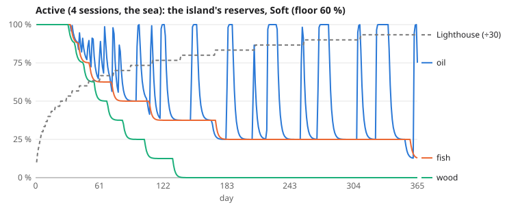
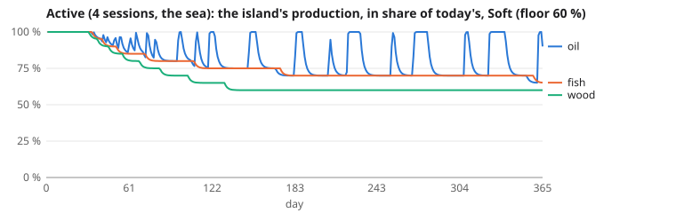
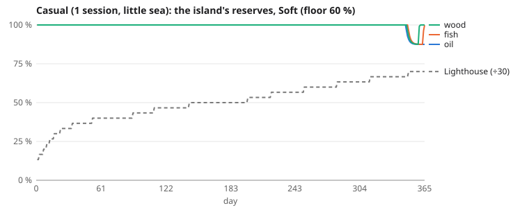
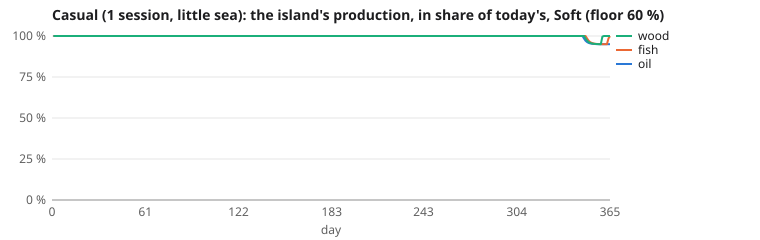
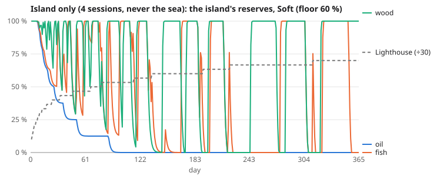
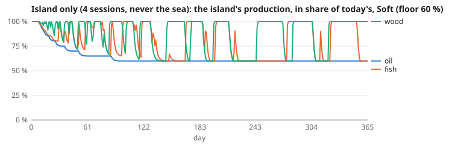
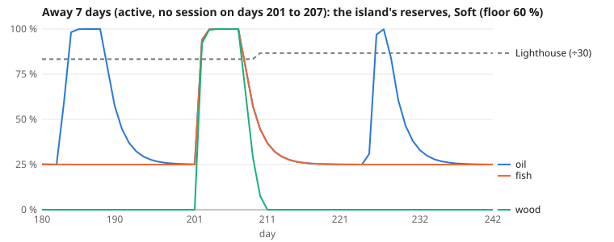
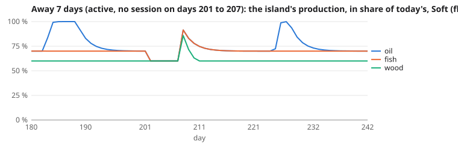
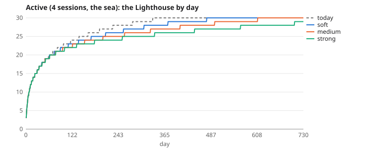
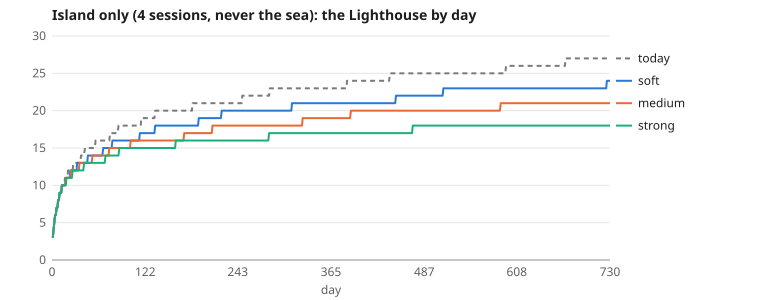

# Study: the island runs out of breath

> **Decision of 21 October 2026: not adopted.** No depletion setting enters the game, neither now nor after task 7; no value of this study does. The reasons:
>
> - the depletion bites only in the late game, where the game is already slowest (waiting for resources goes from 1.6 to 10 hours a day with the soft setting);
> - the player who was away ends ahead of the one who plays;
> - the sea is already necessary for oil.
>
> Instead of pushing (a poorer island), the game will pull: a richer sea. This page stays as the study's record; its pull request stays a draft and is not merged.

**A study by simulation (owner, 21 October). Nothing in the game changes:** no rule of `shared/src/rules/`, no balance value, no code of the client or the server. Every speed and threshold below is a proposal to discuss; none enters the game without the owner's agreement on each value.

The simulation is `tools/balance/depletion.ts`, beside the balance's simulator, and `npm run study:depletion` writes the tables and charts of this page (`tools/balance/depletion-run.ts`). It plays the balance's players (`tools/balance/simulate.ts`) with the rules of `shared/` as they are, over 730 days.

## In short

- **Before the Lighthouse 15–20, no setting changes anything for a player who sails.** The pace there is set by the upgrade durations, not by resources. The active player also keeps the Lumberyard, the Fishery and the Refinery low (Refinery 2 at Lighthouse 10, 6 at Lighthouse 15), so their island barely wears before the Lighthouse 16. The first 7 days of a new player are the same in every setting.
- **The sea is already needed today, for oil, from day 1.** For the active player, the island gives only 7 to 25 % of the oil, depending on the Lighthouse's level (the wrecks give the rest). Without the sea, with the balance's order of play, the active player's city cannot hold the Mist at Lighthouse 4 to 10 even with no depletion at all.
- **The depletion bites in the late game, where the game is already slowest.** Active player:
  - Lighthouse 25: day 139 today, day 171 soft, day 202 medium, day 254 strong.
  - Lighthouse 30: day 333 today, day 476 soft, day 609 medium, not reached in two years with the strong setting.
  - Hours a day waiting for resources at Lighthouse 26–30: 1.6 today, 10.0 soft, 16.6 medium, 18.4 strong.
- **The island-only player is hit hardest.** On day 730 they reach Lighthouse 27 today, 24 soft, 21 medium and 18 strong.
- **The survival rule holds with the soft and medium settings, not the strong one,** for a city whose Refinery keeps up with its Lighthouse. Margins at the floor are +135 % soft, +56 % medium and −2 % strong (strong needs the Refining research). It never holds for the active player's own city without the sea, but that is already the case today.
- **No spiral.** A lost Mist damages the rafts, which costs fish, not oil. A city either holds every Mist after the first day, or loses them all from the first day (a steady deficit that does not deepen). Repairs never make it worse: the oil is never left over for one.
- **Back after 7 days: full reserves,** with one rule added: past 30 hours without a session, the island rests and gives only its floor. The player who was away then ends 6 to 7 days *ahead* of the one who stayed, at Lighthouse 30 (soft and medium settings). Without the fallow, they would be 9 to 16 days ahead.
- **The Tide (+15 % on one resource a week) speeds up the start** (Lighthouse 8: 23 % sooner for the active player) and the late game by about 4 %. It does not offset the depletion.

## Recommendation

**The soft setting (floor 60 %), and not before task 7.** Only the soft setting keeps the survival rule with a wide margin: +135 % for a city whose Refinery follows its Lighthouse, +56 % at the lowest for the island-only player's own city. It leaves the casual player almost untouched (Lighthouse 25 four per cent later) and lets the island-only player still reach Lighthouse 24 in two years. The other two settings fail on survival:

- **Medium:** the island-only player's lowest margin falls to +4 %, and the active player's city without the sea loses Mists from Lighthouse 3 to 29.
- **Strong:** a well-built city without the Refining research does not hold the Mist (−2 %), and the island-only player stops at Lighthouse 18.

Three conditions before the soft setting can enter the game:

1. **Task 7 first.** The depletion stretches the late game, where the upgrade durations already make it a wall. Lighthouse 25 to 30 takes the active player 195 days today and 304 days with the soft setting. Shipping it before that wall is fixed would add to it.
2. **A guarantee for the Mist that does not depend on how the city was built.** For example, the oil the Lighthouse burns could be exempt from depletion. The floor rule alone does not protect a city whose Refinery lags, and such cities already exist today.
3. **The rest rule settled with the owner**: 30 hours without a session, a fallow at the floor while resting, and the small edge it gives the player who comes back (6 days at Lighthouse 30 with the soft setting).

**Not reached by any setting:** "up to the Lighthouse 7 the island suffices; around the Lighthouse 8 the sea becomes necessary". Before Lighthouse 15, resources do not set the pace, so a depletion cannot make the sea necessary there. And for oil, the sea is already necessary from the start. Reaching that goal would take a balance change (costs against durations around the Lighthouse 8), not a depletion.

## The model (proposed values, none adopted)

For each resource of the island (oil, fish, wood), a reserve `R` from 0 to 1, starting full:

| What | Proposed | What it means |
| --- | --- | --- |
| The island's production | the rules' production × (floor + (1 − floor) × R) | never under the floor; the Kelp Greenhouses on the rafts are left out (they are not the island's) |
| Floor | 60 % soft, 40 % medium, 25 % strong | the three settings asked for; their speeds are the same, so only the floor tells them apart |
| Levels the island renews | 7 | a Lumberyard, Fishery or Refinery up to level 7 never wears the island |
| Wear | 1/384 of the reserve per hour of harvest, per level above 7 | harvested without a pause, the reserve settles at 1 − (level − 7) / 8: 88 % at level 8, 50 % at level 11, 0 from 15 |
| Regrowth while harvested | 1/48 of what is missing per hour | the reserve settles in about two days |
| Regrowth while resting | 1/8 of what is missing per hour | 95 % in a day; the island rests while its storage is full (nothing is harvested) |
| Rest during an absence | past 30 hours without a session | the island is no longer worn, gives only its floor (fallow), and fills again: a week away comes back to full reserves; one session a day never reaches it |
| The Tide (a variant) | +15 % to one resource's harvest, a week each (wood, fish, oil in turn) | it also wears the island 15 % faster |

**How it is played without changing a rule:** at each step the study gives the rules the city with its Refinery, Fishery and Lumberyard scaled by the island's share, lets `advance` run (the Mist, the storage, the fleets, the stoked Lighthouse running dry, all by the rules), then puts the true levels back. With no depletion, the study gives exactly the balance's run (`tools/balance/depletion.test.ts`).

## The players

| Profile | Sessions | Play |
| --- | --- | --- |
| Active | 4 a day: 8:00, 12:30, 18:00, 22:00 | the balance's order of play, the sea included (wrecks, camps, the Leviathan) |
| Casual | 1 a day: 20:00 | the same order; one session a day sends its fleets once, so it uses little of the sea |
| Island only | as the active player | never the sea; the Refinery, the Lumberyard and the Fishery before the Lighthouse while below it (with the balance's order, a player without the sea stays at Lighthouse 4, the Lighthouse's oil kept aside while the Refinery stays at 1) |
| Away 7 days | as the active player | no session from day 201 to day 207 (Lighthouse 24 or 25, when the depletion bites) |
| The first 7 days | the active and the casual player's first week | |

Everything that exists is played by the rules: the Mist three times a day and stoking (×1.5, week 7), the wrecks (2 h refill, +25 % per Lighthouse level above 24), the storage, the repairs in oil (2 per point), the buildings on rafts, the Leviathan, the objectives and the chests. **A guess, apart:** the Fish Shoals and Wooded Isles of the map, which fleets cannot reach today. They are played as the wrecks are (same hold, same trip, 2 h refill, the map's amounts of 360 to 600). While the Lighthouse's next level lacks wood or fish, the player sends up to half their free fleets there.

**Not modeled:** other players, the daily recruitment, a player who changes their order of play when the island wears out, the shoals' and isles' fleets as busy for the camps and the Leviathan (only the wrecks see them), a morale other than 84.

## Results

<!-- depletion:generated:start (npm run study:depletion) -->

_48 runs of 730 days each; the speeds of the three settings: the island renews 7 levels of each producer, each level above takes 0.26 % of the reserve per hour of harvest, the reserve fills again by 2.1 % of what is missing per hour while harvested and 12.5 % while resting._

### 1. Time to reach the Lighthouse levels (days after the city is founded; in brackets, against the game today)

**Active (4 sessions, the sea)**

| Setting | Lighthouse 8 | Lighthouse 10 | Lighthouse 15 | Lighthouse 20 | Lighthouse 25 | Lighthouse 30 | Level on day 730 |
| --- | --- | --- | --- | --- | --- | --- | --- |
| No depletion (the game today) | day 4.3 | day 6.7 | day 24 | day 59 | day 139 | day 333 | 30 |
| Soft (floor 60 %) | day 4.3 (+0 %) | day 6.7 (+0 %) | day 24 (+0 %) | day 61 (+4 %) | day 171 (+23 %) | day 476 (+43 %) | 30 |
| Medium (floor 40 %) | day 4.3 (+0 %) | day 6.7 (+0 %) | day 24 (+0 %) | day 62 (+5 %) | day 202 (+46 %) | day 609 (+83 %) | 30 |
| Strong (floor 25 %) | day 4.3 (+0 %) | day 6.7 (+0 %) | day 24 (+0 %) | day 62 (+6 %) | day 254 (+83 %) | not reached | 29 |

**Casual (1 session, little sea)**

| Setting | Lighthouse 8 | Lighthouse 10 | Lighthouse 15 | Lighthouse 20 | Lighthouse 25 | Lighthouse 30 | Level on day 730 |
| --- | --- | --- | --- | --- | --- | --- | --- |
| No depletion (the game today) | day 12 | day 22 | day 143 | day 314 | day 532 | not reached | 27 |
| Soft (floor 60 %) | day 12 (+0 %) | day 22 (+0 %) | day 143 (+0 %) | day 314 (+0 %) | day 554 (+4 %) | not reached | 27 |
| Medium (floor 40 %) | day 12 (+0 %) | day 22 (+0 %) | day 143 (+0 %) | day 314 (+0 %) | day 568 (+7 %) | not reached | 26 |
| Strong (floor 25 %) | day 12 (+0 %) | day 22 (+0 %) | day 143 (+0 %) | day 314 (+0 %) | day 581 (+9 %) | not reached | 26 |

**Island only (4 sessions, never the sea)**

| Setting | Lighthouse 8 | Lighthouse 10 | Lighthouse 15 | Lighthouse 20 | Lighthouse 25 | Lighthouse 30 | Level on day 730 |
| --- | --- | --- | --- | --- | --- | --- | --- |
| No depletion (the game today) | day 6.7 | day 12 | day 42 | day 134 | day 442 | not reached | 27 |
| Soft (floor 60 %) | day 6.7 (+0 %) | day 12 (+0 %) | day 67 (+58 %) | day 221 (+65 %) | not reached | not reached | 24 |
| Medium (floor 40 %) | day 6.7 (+0 %) | day 12 (+1 %) | day 74 (+75 %) | day 391 (+191 %) | not reached | not reached | 21 |
| Strong (floor 25 %) | day 6.7 (+0 %) | day 12 (+1 %) | day 87 (+107 %) | not reached | not reached | not reached | 18 |

**Away 7 days (active, no session on days 201 to 207)**

| Setting | Lighthouse 8 | Lighthouse 10 | Lighthouse 15 | Lighthouse 20 | Lighthouse 25 | Lighthouse 30 | Level on day 730 |
| --- | --- | --- | --- | --- | --- | --- | --- |
| No depletion (the game today) | day 4.3 | day 6.7 | day 24 | day 59 | day 139 | day 333 | 30 |
| Soft (floor 60 %) | day 4.3 (+0 %) | day 6.7 (+0 %) | day 24 (+0 %) | day 61 (+4 %) | day 171 (+23 %) | day 470 (+41 %) | 30 |
| Medium (floor 40 %) | day 4.3 (+0 %) | day 6.7 (+0 %) | day 24 (+0 %) | day 62 (+5 %) | day 202 (+46 %) | day 602 (+81 %) | 30 |
| Strong (floor 25 %) | day 4.3 (+0 %) | day 6.7 (+0 %) | day 24 (+0 %) | day 62 (+6 %) | day 248 (+78 %) | not reached | 29 |

**The Tide (+15 % to one island resource, a week each): the same players**

| Profile | Setting | Lighthouse 8 | Lighthouse 10 | Lighthouse 15 | Lighthouse 20 | Lighthouse 25 | Lighthouse 30 | Level on day 730 |
| --- | --- | --- | --- | --- | --- | --- | --- | --- |
| Active | No depletion | day 3.3 (-23 %) | day 5.7 (-15 %) | day 22 (-6 %) | day 56 (-5 %) | day 132 (-5 %) | day 319 (-4 %) | 30 |
| Active | Soft | day 3.3 (-23 %) | day 5.7 (-15 %) | day 22 (-6 %) | day 57 (-7 %) | day 164 (-5 %) | day 456 (-4 %) | 30 |
| Active | Medium | day 3.3 (-23 %) | day 5.7 (-15 %) | day 22 (-6 %) | day 59 (-5 %) | day 196 (-3 %) | day 586 (-4 %) | 30 |
| Active | Strong | day 3.3 (-23 %) | day 5.7 (-15 %) | day 22 (-6 %) | day 60 (-4 %) | day 251 (-1 %) | not reached | 29 |
| Casual | No depletion | day 12 (+0 %) | day 21 (-5 %) | day 131 (-8 %) | day 291 (-7 %) | day 499 (-6 %) | not reached | 28 |
| Casual | Soft | day 12 (+0 %) | day 21 (-5 %) | day 131 (-8 %) | day 291 (-7 %) | day 521 (-6 %) | not reached | 27 |
| Casual | Medium | day 12 (+0 %) | day 21 (-5 %) | day 131 (-8 %) | day 291 (-7 %) | day 536 (-6 %) | not reached | 27 |
| Casual | Strong | day 12 (+0 %) | day 21 (-5 %) | day 131 (-8 %) | day 291 (-7 %) | day 549 (-6 %) | not reached | 26 |
| Island only | No depletion | day 6.7 (+0 %) | day 12 (+0 %) | day 48 (+13 %) | day 127 (-5 %) | day 416 (-6 %) | not reached | 27 |
| Island only | Soft | day 6.7 (+0 %) | day 12 (+0 %) | day 58 (-13 %) | day 213 (-4 %) | not reached | not reached | 24 |
| Island only | Medium | day 6.7 (+0 %) | day 12 (+0 %) | day 62 (-16 %) | day 364 (-7 %) | not reached | not reached | 21 |
| Island only | Strong | day 6.7 (+0 %) | day 12 (+0 %) | day 81 (-7 %) | not reached | not reached | not reached | 18 |

_In brackets: against the same setting without the Tide._

**With the Fish Shoals and Wooded Isles open (a guess: fleets go there as to the wrecks, same hold, trip and 2 h refill, the map's amounts)**

| Profile | Setting | Lighthouse 8 | Lighthouse 10 | Lighthouse 15 | Lighthouse 20 | Lighthouse 25 | Lighthouse 30 | Level on day 730 |
| --- | --- | --- | --- | --- | --- | --- | --- | --- |
| Active | No depletion | day 4.3 (+0 %) | day 7.1 (+6 %) | day 23 (-3 %) | day 53 (-9 %) | day 137 (-2 %) | day 342 (+3 %) | 30 |
| Active | Soft | day 4.3 (+0 %) | day 7.1 (+6 %) | day 23 (-3 %) | day 54 (-12 %) | day 148 (-14 %) | day 407 (-14 %) | 30 |
| Active | Medium | day 4.3 (+0 %) | day 7.1 (+6 %) | day 23 (-3 %) | day 55 (-12 %) | day 160 (-21 %) | day 455 (-25 %) | 30 |
| Active | Strong | day 4.3 (+0 %) | day 7.1 (+6 %) | day 23 (-3 %) | day 55 (-12 %) | day 167 (-34 %) | day 523 | 30 |
| Casual | No depletion | day 12 (+0 %) | day 23 (+5 %) | day 146 (+2 %) | day 303 (-4 %) | day 525 (-1 %) | not reached | 27 |
| Casual | Soft | day 12 (+0 %) | day 23 (+5 %) | day 146 (+2 %) | day 303 (-4 %) | day 549 (-1 %) | not reached | 27 |
| Casual | Medium | day 12 (+0 %) | day 23 (+5 %) | day 146 (+2 %) | day 303 (-4 %) | day 564 (-1 %) | not reached | 26 |
| Casual | Strong | day 12 (+0 %) | day 23 (+5 %) | day 146 (+2 %) | day 303 (-4 %) | day 578 (-1 %) | not reached | 26 |

_In brackets: against the same setting with today's sea._

### 2. Where the resources come from: the island's share of the oil, fish and wood gathered, by Lighthouse levels

**Active (4 sessions, the sea)**: all three together, then the oil alone

| Setting | Lighthouse 1–7 | Lighthouse 8–10 | Lighthouse 11–15 | Lighthouse 16–20 | Lighthouse 21–25 | Lighthouse 26–30 |
| --- | --- | --- | --- | --- | --- | --- |
| No depletion (the game today) | 47 % | 59 % | 61 % | 67 % | 69 % | 53 % |
| No depletion: oil | 10 % | 16 % | 20 % | 24 % | 25 % | 7 % |
| Soft (floor 60 %) | 47 % | 59 % | 61 % | 64 % | 60 % | 42 % |
| Soft: oil | 10 % | 16 % | 20 % | 21 % | 18 % | 5 % |
| Medium (floor 40 %) | 47 % | 59 % | 61 % | 62 % | 52 % | 36 % |
| Medium: oil | 10 % | 16 % | 20 % | 20 % | 13 % | 4 % |
| Strong (floor 25 %) | 47 % | 59 % | 61 % | 61 % | 44 % | 31 % |
| Strong: oil | 10 % | 16 % | 20 % | 19 % | 8 % | 4 % |

**Casual (1 session, little sea)**: all three together, then the oil alone

| Setting | Lighthouse 1–7 | Lighthouse 8–10 | Lighthouse 11–15 | Lighthouse 16–20 | Lighthouse 21–25 | Lighthouse 26–30 |
| --- | --- | --- | --- | --- | --- | --- |
| No depletion (the game today) | 87 % | 83 % | 79 % | 85 % | 87 % | 84 % |
| No depletion: oil | 46 % | 58 % | 66 % | 63 % | 62 % | 52 % |
| Soft (floor 60 %) | 87 % | 83 % | 79 % | 85 % | 85 % | 81 % |
| Soft: oil | 46 % | 58 % | 66 % | 63 % | 57 % | 45 % |
| Medium (floor 40 %) | 87 % | 83 % | 79 % | 85 % | 83 % | 79 % |
| Medium: oil | 46 % | 58 % | 66 % | 63 % | 54 % | 41 % |
| Strong (floor 25 %) | 87 % | 83 % | 79 % | 85 % | 82 % | 77 % |
| Strong: oil | 46 % | 58 % | 66 % | 63 % | 51 % | 35 % |

**Active (4 sessions, the sea), with the shoals and isles open (guess)**: all three together, then the oil alone

| Setting | Lighthouse 1–7 | Lighthouse 8–10 | Lighthouse 11–15 | Lighthouse 16–20 | Lighthouse 21–25 | Lighthouse 26–30 |
| --- | --- | --- | --- | --- | --- | --- |
| No depletion (the game today) | 49 % | 51 % | 57 % | 65 % | 66 % | 53 % |
| No depletion: oil | 26 % | 27 % | 28 % | 33 % | 33 % | 12 % |
| Soft (floor 60 %) | 49 % | 51 % | 57 % | 63 % | 58 % | 43 % |
| Soft: oil | 26 % | 27 % | 28 % | 31 % | 28 % | 13 % |
| Medium (floor 40 %) | 49 % | 51 % | 57 % | 61 % | 53 % | 36 % |
| Medium: oil | 26 % | 27 % | 28 % | 30 % | 24 % | 10 % |
| Strong (floor 25 %) | 49 % | 51 % | 57 % | 60 % | 48 % | 27 % |
| Strong: oil | 26 % | 27 % | 28 % | 29 % | 21 % | 7 % |

_The island-only player takes 100 % from the island by definition. A dash: the bracket was not reached._

### 3. Hours a day a builder waits for resources (the last session found nothing it could pay for), by Lighthouse levels

**Active (4 sessions, the sea)**

| Setting | Lighthouse 1–7 | Lighthouse 8–10 | Lighthouse 11–15 | Lighthouse 16–20 | Lighthouse 21–25 | Lighthouse 26–30 | Whole run |
| --- | --- | --- | --- | --- | --- | --- | --- |
| No depletion (the game today) | 13.4 | 12.7 | 11.2 | 5.8 | 4.5 | 1.6 | 2.6 |
| Soft (floor 60 %) | 13.4 | 12.7 | 11.2 | 7.6 | 10.5 | 10.0 | 10.0 |
| Medium (floor 40 %) | 13.4 | 12.7 | 11.2 | 8.6 | 14.0 | 16.6 | 15.2 |
| Strong (floor 25 %) | 13.4 | 12.7 | 11.2 | 9.0 | 17.0 | 18.4 | 17.0 |

**Casual (1 session, little sea)**

| Setting | Lighthouse 1–7 | Lighthouse 8–10 | Lighthouse 11–15 | Lighthouse 16–20 | Lighthouse 21–25 | Lighthouse 26–30 | Whole run |
| --- | --- | --- | --- | --- | --- | --- | --- |
| No depletion (the game today) | 14.2 | 20.1 | 22.2 | 18.8 | 16.3 | 14.7 | 17.9 |
| Soft (floor 60 %) | 14.2 | 20.1 | 22.2 | 18.8 | 17.2 | 17.9 | 18.8 |
| Medium (floor 40 %) | 14.2 | 20.1 | 22.2 | 18.8 | 17.8 | 20.9 | 19.3 |
| Strong (floor 25 %) | 14.2 | 20.1 | 22.2 | 18.8 | 18.2 | 24.0 | 19.6 |

**Island only (4 sessions, never the sea)**

| Setting | Lighthouse 1–7 | Lighthouse 8–10 | Lighthouse 11–15 | Lighthouse 16–20 | Lighthouse 21–25 | Lighthouse 26–30 | Whole run |
| --- | --- | --- | --- | --- | --- | --- | --- |
| No depletion (the game today) | 13.3 | 13.0 | 13.9 | 13.7 | 16.6 | 18.8 | 16.3 |
| Soft (floor 60 %) | 13.3 | 16.3 | 19.7 | 20.9 | 21.9 | – | 21.2 |
| Medium (floor 40 %) | 13.3 | 15.8 | 20.7 | 22.5 | 24.0 | – | 22.4 |
| Strong (floor 25 %) | 13.3 | 17.0 | 22.2 | 23.6 | – | – | 23.1 |

**Away 7 days (active, no session on days 201 to 207)**

| Setting | Lighthouse 1–7 | Lighthouse 8–10 | Lighthouse 11–15 | Lighthouse 16–20 | Lighthouse 21–25 | Lighthouse 26–30 | Whole run |
| --- | --- | --- | --- | --- | --- | --- | --- |
| No depletion (the game today) | 13.4 | 12.7 | 11.2 | 5.8 | 4.5 | 1.6 | 2.6 |
| Soft (floor 60 %) | 13.4 | 12.7 | 11.2 | 7.6 | 10.5 | 10.0 | 10.0 |
| Medium (floor 40 %) | 13.4 | 12.7 | 11.2 | 8.6 | 13.1 | 16.5 | 15.0 |
| Strong (floor 25 %) | 13.4 | 12.7 | 11.2 | 9.0 | 16.8 | 18.5 | 17.0 |

### 4. The Mist's oil with the island empty, at every Lighthouse level

A day with the reserve of oil at 0 (the island at its floor), no oil in store and no sea: what the Refinery makes in 24 hours (no slowdown in the Mist, the Lighthouse being stoked) against what the Lighthouse burns (18 hours as usual, 6 hours stoked, ×1.5). **Margin**: what is left at the end of the day, in share of what was burnt. **No**: the oil made between two Mists does not cover what a Mist burns beyond what it makes, so a Mist is lost with an empty store. "Today" is the same day with the island at 100 %: the game as it is, without the sea.

**A city whose Refinery keeps up with its Lighthouse** (the same at every level: what is made and what is burnt both grow with it; morale 84 as in every city of the balance, so no bonus):

| Refining research | Today (100 %) | Soft (floor 60 %) | Medium (floor 40 %) | Strong (floor 25 %) |
| --- | --- | --- | --- | --- |
| 0 | +291 % | +135 % | +56 % | -2 %, **no** |
| 1 | +330 % | +158 % | +72 % | +8 % |
| 2 | +369 % | +182 % | +88 % | +17 % |
| 3 | +408 % | +205 % | +103 % | +27 % |

**Each player's own city, as it was when it reached each level** (the lowest margin over levels 2 to 30, and the levels where a Mist is lost):

| Profile | Today (100 %) | Soft (floor 60 %) | Medium (floor 40 %) | Strong (floor 25 %) |
| --- | --- | --- | --- | --- |
| Active (4 sessions, the sea) | -44 %; lost at: 6 levels (4–10) | -66 %; lost at: 11 levels (3–13) | -78 %; lost at: 17 levels (3–29) | -86 %; lost at: all |
| Casual (1 session, little sea) | -35 %; lost at: 9 levels (4–15) | -61 %; lost at: 17 levels (3–19) | -74 %; lost at: 23 levels (3–25) | -84 %; lost at: all |
| Island only (4 sessions, never the sea) | +161 %; lost at: none | +56 %; lost at: none | +4 %; lost at: none | -35 %; lost at: 13 levels (3–27) |

The active player's Refinery, by Lighthouse level (the balance's order: the Lighthouse first, then the lowest building, the Lighthouse's cost kept aside): 5: 1, 10: 2, 15: 6, 20: 10, 25: 13, 30: 15.

**Mists missed over the whole run** (the order to stoke left on, as for every player of the balance):

| Profile | No depletion (the game today) | Soft (floor 60 %) | Medium (floor 40 %) | Strong (floor 25 %) |
| --- | --- | --- | --- | --- |
| Active (4 sessions, the sea) | 0 | 0 | 0 | 0 |
| Casual (1 session, little sea) | 5 | 5 | 5 | 5 |
| Island only (4 sessions, never the sea) | 0 | 0 | 0 | 1 |
| Away 7 days (active, no session on days 201 to 207) | 0 | 0 | 0 | 0 |

### 5. Looking for a spiral

The worst case: a city as it was at a Lighthouse level, its oil gone, its island held at the floor, no sea and nothing built for 14 days, the order to stoke on, the rafts repaired as soon as one is below 60 (paid in oil) as the balance's player does. Mists missed over days 8 to 14 (21 Mists), once the first days are past; in brackets, over the 14 days. A row "no repairs" is added only where it differs: everywhere else, the same runs without any repair give the same numbers.

| City, setting | Lighthouse 5 | Lighthouse 8 | Lighthouse 10 | Lighthouse 15 | Lighthouse 20 | Lighthouse 25 | Lighthouse 30 |
| --- | --- | --- | --- | --- | --- | --- | --- |
| Island-only player's city, Today (100 %) | 0 (0) | 0 (0) | 0 (0) | 0 (0) | 0 (0) | 0 (0) | – |
| Island-only player's city, Soft (floor 60 %) | 0 (0) | 0 (0) | 0 (0) | 0 (0) | 0 (0) | 0 (0) | – |
| Island-only player's city, Medium (floor 40 %) | 0 (0) | 0 (0) | 0 (0) | 0 (0) | 0 (0) | 0 (0) | – |
| Island-only player's city, Strong (floor 25 %) | 21 (42) | 21 (42) | 0 (0) | 0 (0) | 0 (1) | 21 (42) | – |
| Active player's city, Today (100 %) | 21 (42) | 0 (0) | 21 (42) | 0 (1) | 0 (0) | 0 (1) | 0 (0) |
| Active player's city, Soft (floor 60 %) | 21 (42) | 21 (42) | 21 (42) | 0 (1) | 0 (0) | 0 (1) | 0 (0) |
| Active player's city, Medium (floor 40 %) | 21 (42) | 21 (42) | 21 (42) | 21 (42) | 0 (1) | 0 (1) | 0 (1) |
| Active player's city, Strong (floor 25 %) | 21 (42) | 21 (42) | 21 (42) | 21 (42) | 21 (42) | 21 (42) | 21 (42) |

### 6. Back after 7 days away

The active player, away from day 201 to day 207 (no session), against the same player who stayed, under the same setting.

| Setting | Reserves when leaving (oil / fish / wood) | On return | Lighthouse | Mists missed while away | Rafts damaged | Later than the player who stayed, at Lighthouse | … | … | Reserves back to the stayer's after |
| --- | --- | --- | --- | --- | --- | --- | --- | --- | --- |
| No depletion (the game today) | – | – | 27 | 0 | 0 of 7 | 28: 0 days | 29: 1 day | 30: 0 days | – |
| Soft (floor 60 %) | 25 % / 25 % / 0 % | 100 % / 100 % / 100 % | 25 | 0 | 0 of 7 | 26: 0 days | 27: -3 days | 30: -6 days | 3 days |
| Medium (floor 40 %) | 38 % / 38 % / 0 % | 100 % / 100 % / 100 % | 25 | 0 | 0 of 7 | 26: -4 days | 27: -7 days | 30: -7 days | 8 days |
| Strong (floor 25 %) | 100 % / 38 % / 0 % | 100 % / 100 % / 100 % | 24 | 0 | 0 of 7 | 25: -6 days | 26: -6 days | 30: – | 6 days |

Without the fallow (the island away gives as its rebuilt reserve allows), the player away overtakes the one who stayed:

| Setting | Lighthouse on return | Later than the player who stayed, at Lighthouse 30 |
| --- | --- | --- |
| Soft (floor 60 %) | 25 | -9 days |
| Medium (floor 40 %) | 25 | -16 days |
| Strong (floor 25 %) | 24 | – |

### 7. The island-only player

| Setting | Lighthouse 8 | Lighthouse 10 | Lighthouse 15 | Lighthouse 20 | Lighthouse 25 | Lighthouse 30 | Level on day 730 | Level on day 365 |
| --- | --- | --- | --- | --- | --- | --- | --- | --- |
| No depletion (the game today) | day 6.7 | day 12 | day 42 | day 134 | day 442 | not reached | 27 | 23 |
| Soft (floor 60 %) | day 6.7 | day 12 | day 67 | day 221 | not reached | not reached | 24 | 21 |
| Medium (floor 40 %) | day 6.7 | day 12 | day 74 | day 391 | not reached | not reached | 21 | 19 |
| Strong (floor 25 %) | day 6.7 | day 12 | day 87 | not reached | not reached | not reached | 18 | 17 |

### The first 7 days of a new player (Lighthouse at the end of each day)

| Profile | Setting | Day 1 | Day 2 | Day 3 | Day 4 | Day 5 | Day 6 | Day 7 | Reserves on day 7 (oil / fish / wood), Soft (floor 60 %) |
| --- | --- | --- | --- | --- | --- | --- | --- | --- | --- |
| Active | No depletion (the game today) | 3 | 5 | 6 | 7 | 8 | 9 | 9 |  |
| Active | Soft (floor 60 %) | 3 | 5 | 6 | 7 | 8 | 9 | 9 | 100 % / 100 % / 100 % |
| Active | Medium (floor 40 %) | 3 | 5 | 6 | 7 | 8 | 9 | 9 |  |
| Active | Strong (floor 25 %) | 3 | 5 | 6 | 7 | 8 | 9 | 9 |  |
| Casual | No depletion (the game today) | 4 | 4 | 5 | 5 | 5 | 5 | 6 |  |
| Casual | Soft (floor 60 %) | 4 | 4 | 5 | 5 | 5 | 5 | 6 | 100 % / 100 % / 100 % |
| Casual | Medium (floor 40 %) | 4 | 4 | 5 | 5 | 5 | 5 | 6 |  |
| Casual | Strong (floor 25 %) | 4 | 4 | 5 | 5 | 5 | 5 | 6 |  |

### Sensitivity (Soft (floor 60 %): depletion and regrowth half as fast and twice as fast; an island that renews 4 levels of each producer instead of 7)

| Profile | Speeds | Lighthouse 8 | Lighthouse 10 | Lighthouse 15 | Lighthouse 20 | Lighthouse 25 | Lighthouse 30 | Level on day 730 |
| --- | --- | --- | --- | --- | --- | --- | --- | --- |
| Active | as proposed | day 4.3 | day 6.7 | day 24 | day 61 | day 171 | day 476 | 30 |
| Active | speeds ×0.5 | day 4.3 | day 6.7 | day 24 | day 61 | day 168 | day 474 | 30 |
| Active | speeds ×2 | day 4.3 | day 6.7 | day 24 | day 61 | day 170 | day 476 | 30 |
| Active | renews 4 levels, not 7 | day 4.3 | day 6.7 | day 24 | day 66 | day 190 | day 494 | 30 |
| Island only | as proposed | day 6.7 | day 12 | day 67 | day 221 | not reached | not reached | 24 |
| Island only | speeds ×0.5 | day 6.7 | day 12 | day 58 | day 221 | not reached | not reached | 24 |
| Island only | speeds ×2 | day 6.7 | day 12 | day 54 | day 222 | not reached | not reached | 24 |
| Island only | renews 4 levels, not 7 | day 6.9 | day 14 | day 81 | day 240 | not reached | not reached | 23 |

### The end of the game (task 7)

| Profile | Setting | Lighthouse 25 | Lighthouse 30 | From 25 to 30 |
| --- | --- | --- | --- | --- |
| Active | No depletion (the game today) | day 139 | day 333 | 195 days |
| Active | Soft (floor 60 %) | day 171 | day 476 | 304 days |
| Active | Medium (floor 40 %) | day 202 | day 609 | 407 days |
| Active | Strong (floor 25 %) | day 254 | not reached | – |
| Casual | No depletion (the game today) | day 532 | not reached | – |
| Casual | Soft (floor 60 %) | day 554 | not reached | – |
| Casual | Medium (floor 40 %) | day 568 | not reached | – |
| Casual | Strong (floor 25 %) | day 581 | not reached | – |
| Island only | No depletion (the game today) | day 442 | not reached | – |
| Island only | Soft (floor 60 %) | not reached | not reached | – |
| Island only | Medium (floor 40 %) | not reached | not reached | – |
| Island only | Strong (floor 25 %) | not reached | not reached | – |

<!-- depletion:generated:end -->

## Charts (soft setting)

The reserves and the island's production, day by day: the active player, the casual player, the island-only player, and the player away around their absence. The dashed gray line is the Lighthouse's level (÷ 30).

The Lighthouse by day, in the four settings:

**What the charts show.**

- **Active player:** the wood wears first and is empty from about day 140. The oil empties and fills again in turns: its storage fills, so the island rests.
- **Island-only player:** the island swings between empty and full, because every time the storage fills, the island rests.
- **Player away:** the reserves fill in two days, then wear back to the level of the player who stayed within 3 to 8 days, depending on the setting.

## Risks

- **Playing less to grow faster.** Any rule that brings a player back to full reserves helps them against a player whose island is worn. With the fallow, the gain is 6 to 7 days at Lighthouse 30; without it, 9 to 16. A player could learn to stay away. Capping the refill on return (to 60 % for example) would reduce it; this is not measured here.
- **The Mist depends on how the city was built.** The balance's active and casual players keep their Refinery at about half the Lighthouse's level and live on the wrecks' oil. Without the sea, their city loses Mists at Lighthouse 4 to 10 today, 3 to 13 soft, 3 to 29 medium, and everywhere strong. With the sea, the active player lost no Mist in any setting; the casual player lost 5 in two years, in every setting, today included. A player cut off from the sea (in the Mist, its fleets reach only the Lighthouse's light) is the one at risk.
- **A late game waiting for resources.** At Lighthouse 26–30, the active player waits 10 hours a day with the soft setting, against 1.6 today. The late game becomes slow twice over: by the durations, and by the resources.
- **The shoals and isles would not be enough as they are on the map.** Opened as wrecks, they save the active player 69 days to Lighthouse 30 with the soft setting (day 407 instead of 476), still 74 days later than today. Their amounts (360 to 600) are those of the first levels; to count in the late game, they would need to grow with the level as the wrecks do past 24.
- **The speeds matter little; the threshold matters more.** Speeds half as fast or twice as fast change the active player's Lighthouse 30 by 2 days at most. An island that renews 4 levels instead of 7 delays Lighthouse 20 by 5 days and Lighthouse 30 by 18 days.
- **What the study cannot see:** players who change their order of play when the island wears (for example, upgrading the producers sooner), which the depletion would push them to do.

## The end of the game (task 7, not corrected here)

- **The wall is the other buildings, not the Lighthouse.** The Lighthouse 29 → 30 takes 43 days. The eight other buildings take 3,196 to 4,261 days from level 29 to 30, that is 9 to 12 years. The producers therefore stall: the active player's Refinery is at 13 at Lighthouse 25 and 15 at Lighthouse 30.
- **Meanwhile, the Lighthouse's costs keep growing.** It costs 104,000 wood from 20 to 21, and 1,102,550 wood and 735,040 oil from 29 to 30. The island's production stops growing while the costs go on. Today the gap is filled by time and by the sea (wrecks richer past 24).
- **A depletion adds a second ceiling to that same island.** The late game becomes resource-bound on top of duration-bound. The active player's Lighthouse 25 → 30 goes from 195 days to 304 soft and 407 medium. The casual player does not reach Lighthouse 30 in two years in any setting, today included.
- **The order matters:** task 7 should set the late game's durations before a depletion is weighed again. The study's numbers past Lighthouse 20 will change with it.

## Running it again

`npm run study:depletion` (about a minute) rewrites the tables between the markers above and the charts in `docs/studies/depletion/`. `npm test` checks that the study, with no depletion, plays exactly the balance's game, that the reserves stay between 0 and 1, and the Mist's margins. It does not check that this page is up to date: the 48 runs are too long for every test run.
