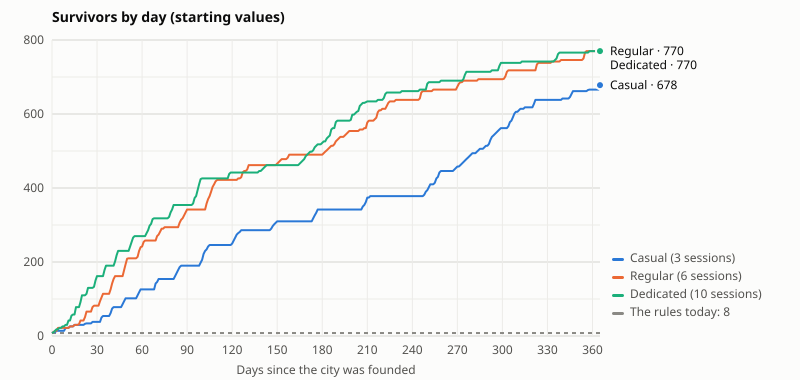

# The population (study)

A study only, at the owner's request of 24 October, after a game report: the island's population never grows (8/22), no new house can be built, and there are only 2 builders. It measures, by simulation, a population that grows, a House to build on the plots won, and builders that come with the survivors, on today's economy (E, the slower build times, the costs past 15); and it says, point by point, what the game would need. **It changes no value: nothing goes into the game without the owner's agreement, value by value.**

## Today

- **The survivors never change:** 8 from the start to the end. The Shelters give room (6 + 4 a level: the top bar's "8/22" at the Shelters 4, "8/126" at 30), but nothing fills it.
- **The morale never changes:** 84 from the start. Its bonus (production ×1.1 at 90 or more) is never reached.
- **The survivors eat 0.6 fish an hour each:** 4.8 for the 8, about 1 % of what the city makes past Lighthouse 20.
- **The fish is never lost, but it piles up:** no day of the balance's players ends with the fish full, but the regular player holds about half the storage in fish from day 90 on (1,024,621 of 1,998,372 on day 180). Only the costs spend it.
- **Two builders** (`BUILDERS`), for every city.
- **The plots won:** up to 39; the three raft buildings take 6 at most (two each). The balance's player moors 7 and builds on 6. The city fabric's houses follow the Shelters' room (two survivors of room to a house, display only, `docs/decisions.md`).

## How it is measured

- **The players:** the balance's three (casual: 3 sessions a day; regular: 6; dedicated: 10), with today's rules, for **two years**. With the rules, the runs are the balance's own: the study checks they give the milestones of `docs/balance.md`, or it stops.
- **The study's rules** (`tools/balance/population-rules.ts`, `population.ts`, `population-hooks.mjs`; `npx tsx tools/balance/population-run.ts`): hour by hour, survivors come while there is room and fish, faster at a higher Lighthouse and a higher morale; the fleets bring some home; the morale moves; the Houses stand on the rafts; the builders follow the survivors. Nothing is changed in `shared/`.
- **The study's player at the shipyard:** the raft buildings first, as the balance plays them (two of each, up to level 3); then a House on every free raft; then the cheaper in wood of the next House level and the next raft. Every spending keeps the Lighthouse's reserve, as the balance's players do.
- **Also played:** three pairs of thresholds for the third and fourth builders; the idle study's option A (production ×3.5) with and without the population (`docs/studies/idle.md`); a city short of fish (its Fishery kept at level 2, never at sea); the balance's player who never stokes (the morale and the Mists).

## What it shows

**1. The population grows, and the room sets its pace.** The regular player has 22 survivors on day 7, 82 on day 30, 342 on day 90, 770 after a year, 786 at the end (the Shelters at 30 and 33 Houses at level 5). Every room is taken 97 to 98 % of the time: once a House level is built, its 4 survivors come within hours (0.3 an hour at Lighthouse 10, 0.7 at 30, and the fleets'). What the player builds is what grows the city. The fleets bring about two thirds of the survivors (504 of 778 for the regular player).

**2. The fish gets a use, and becomes a brake.** The survivors eat 9 to 13 % of the fish made at Lighthouse 10 to 20, 33 to 43 % at Lighthouse 30 (1 % today). With the Houses' cost (1.2 million fish over the game), fish becomes a resource that holds builders back: the regular player's sessions ended short of fish go from 53 to 793 (wood: 432 to 1,340).

**3. No simulated city goes hungry.** Not one hour without fish, even with the Fishery kept at level 2 and never at sea: the Houses cost fish, so the room only grows as fast as the fish allows (246 survivors after a year instead of 770). The hour-by-hour example (section 4) shows the case the players will meet anyway (a long absence, a Fishery left behind): with no fish, no one comes and the morale falls a point an hour toward 40; no one dies or leaves; once fish comes back, the morale climbs back and the survivors come again.

**4. The morale, with these values, matters little.** A fed city stays at 84. The player who never stokes loses 5 for each Mist not held and falls to 81 at the lowest: its survivors then come at most 4 % slower. Its slower start (46 survivors on day 30 instead of 82) comes from its room: its shipyard is busy mending the rafts the Mists damage, and builds fewer Houses. The bonus at 90 stays out of reach, as today: whether to open it is a decision of its own (production +10 % while above 90).

**5. The Lighthouse 30 stays near 6 months; the whole city at 30 comes later.** Lighthouse 30: day 183.9 → 189.9 for the regular player (6.2 months), +5.5 days for the casual player, +6.3 for the dedicated one; Lighthouses 10 and 20 do not move. The whole city at 30 comes 65 days later for the regular player (day 479 → 544), about 100 days later for the other two: the Houses cost 2.4 million wood and 1.2 million fish, and the 32 rafts more 1.2 million wood.

**6. More builders change nothing in the pace.** A third and a fourth builder, at 40 and 120, 100 and 250 or 200 and 500 survivors, move Lighthouse 30 by 6 days at most and the whole city at 30 by 10 days at most, sooner or later, with no order between the thresholds. They are left free more of the time: from 71 % with nothing to start (Lighthouse 21 to 30, two builders) to 84 % with four. With the idle study's A (production ×3.5) too: Lighthouse 30 on day 103.6 with two builders, 103.8 with four. What holds the builders back is the resources and the Lighthouse's reserve, never their number (`docs/studies/idle.md`). The resources study's D (a third builder at Lighthouse 10, a fourth at 20) made the Lighthouse later with the economy of then; with today's, more builders make it neither later nor sooner.

## What the game would need, point by point

### 1. A population that grows

- **Rules (`shared/`):** a new `rules/population.ts` (the arrivals, the morale, the survivors the fleets bring, the room); the city's advance (`state/state.ts`) applies it on the clock's whole hours, so that a city is the same whatever the moments the server computes it; the fleets' return (`rules/sea.ts`) gives the survivors brought home; a Mist's end moves the morale. The fish eaten already follows the survivors (`netRates`).
- **State and saves:** one new field, the survivors on their way (a fraction of one). A migration (shape 12 to 13) gives every city 0, and `parse.ts` checks it. The survivors (8) and the morale (84) are already saved: an old city stays as it was, with room for its 8.
- **Server:** nothing of its own (it applies the shared rules); a cheat test that a client can never send survivors or morale (already refused today).
- **Client:** the top bar's "8/22" moves by itself; a short event ("3 survivors have come", "Your survivors are hungry: no one comes"); the Shelters' sheet says the room and the arrivals. The survivors walking in the city already follow their number (`client/src/city/life/cast.ts`).
- **Models:** none.
- **Difficulty and time:** medium, about 2 to 3 days.
- **Risks:**
  - a city must be the same whatever the requests: the whole hours make it so, and the shared tests must check it;
  - the fish becomes a brake (section 3): to watch in the next balance;
  - nothing changes for a city that never goes hungry, apart from the fish it eats.

### 2. The House

- **Rules (`shared/`):** `rules/rafts.ts` gets a fourth raft building, the House, with its own cost, levels (5) and Lighthouse gate, and no limit of copies; the room counts its levels. `parse.ts` and the actions' check (`state/actions.ts`) accept it; a House above level 3 is read as such.
- **State and saves:** nothing new: a House is a raft's building and level, as the three others. An old city has none.
- **Server:** nothing of its own; cheat tests (a House above what the Lighthouse allows, a House on a raft that has a building).
- **Client:** the raft's sheet offers the House ("room for 4 more survivors") and its upgrade; the city fabric (`client/src/city/fabric/plan.ts`) shows a plot's houses from its House, in its era's style, and fields on the plots without one, as today; the demonstration cities get Houses.
- **Models:** the fabric's houses of each era (tent and hut, wooden, brick, terraced rows, lit houses, solar houses, apartments) are in the game already: no new model.
- **Difficulty and time:** medium to large, about 3 to 4 days, the captures that move shown before their references are redone.
- **Risks:**
  - **the display budget:** the fabric's worst city today shows 63 houses' worth in 11,026 triangles at most (its test allows 14,000). At two survivors of room a house, 786 room would be 393 houses' worth, six times more. A House must therefore be drawn as a few larger houses (the terraced rows count for 3, the apartments for 6), with a fixed number of pieces a plot whatever its level, measured with the fabric test and `?demo=phare30`;
  - **the 70 % in sight:** the houses are put only where they hide no building (`fabric/sight.ts`, `client/test/fabric.test.ts`, `client/test/visible.test.ts`); a plot near a building may show fewer. A test must check every House shows at least one house;
  - **the saves:** none (no new field).

### 3. The builders with the survivors

- **Rules (`shared/`):** `BUILDERS` becomes the builders of the city's survivors: the upgrade's check (`rules/buildings.ts`) reads the survivors, and `parse.ts` keeps as many jobs as the city's builders. The survivors never leave, so a builder once come never goes. Never for sale.
- **State and saves:** nothing new (from the survivors).
- **Server:** a cheat test (a third upgrade refused below the threshold).
- **Client:** the queue shows three or four builders (`client/src/city/queue.ts`); a celebration when a builder comes ("A third builder joins you"); the refusal "Your 3 builders are busy".
- **Models:** none.
- **Difficulty and time:** small, about 1 day.
- **Risks:** none on the saves; the queue's captures move. They do not speed the game (section 6): their worth is in the feel of the sessions, not in the pace.

## The proposed starting values (for the owner's decision, value by value)

- **Arrivals:** 0.1 + 0.02 × the Lighthouse's level survivors an hour (0.3 at Lighthouse 10, 0.7 at 30), × the morale / 84; none without room or without fish.
- **The fleets:** 1 survivor for a wreck salvaged, 2 for a camp beaten, when there is room.
- **Eating:** the rules' 0.6 fish an hour a survivor, unchanged (the Smokehouses still save up to half).
- **Without fish:** no arrivals, the morale toward 40, a point an hour; no one dies or leaves.
- **Morale:** toward 84 with fish, a point an hour; +2 for a Mist held, −5 for a Mist not held; between 0 and 100. The bonus at 90 stays as today (out of reach): to decide apart.
- **The House:** on a free raft, at the shipyard. 600 wood and 300 fish for level 1, ×3 a level (level 5: 48,600 wood and 24,300 fish); 4 survivors of room a level, 5 levels; one level more every 7 Lighthouse levels (level 2 from Lighthouse 7, level 5 from 28). The raft buildings' build times.
- **Builders:** a third at 100 survivors, a fourth at 250 (the regular player: day 33, Lighthouse 20, and day 61, Lighthouse 23). Any of the three pairs measured gives the same pace: the choice is one of feel.

## The proposed order of delivery

1. **The population** with the Shelters' room only: the top bar moves at once (8/22 filled in a few days), the fish gets eaten. Nothing to display beyond the bar and the survivors walking.
2. **The House:** the room for the rest of the game, and the plots won get a use. The display budget is measured there.
3. **The builders,** last: they change nothing in the pace, so they wait for the two others, and for the decision on the idle study (`docs/studies/idle.md`).

## The measures

<!-- population:generated:start (npx tsx tools/balance/population-run.ts) -->

### The values played

- Arrivals: 0.1 + 0.02 × the Lighthouse's level survivors an hour (Lighthouse 10: 0.30; 20: 0.50; 30: 0.70), × the morale / 84; none without fish or room.
- Morale: toward 84 with fish, 40 without, 1 point an hour; +2 for a Mist held, −5 for a Mist not held.
- The fleets: 1 survivor for a wreck salvaged, 2 for a camp beaten, if there is room.
- Eating: the rules' 0.6 fish an hour a survivor, less with the Smokehouses (half at most).
- House: on a free raft, at the shipyard. Level 1 costs 600 wood and 300 fish, ×3 a level (level 5: 48,600 wood, 24,300 fish); 4 survivors of room a level, 5 levels, one more every 7 Lighthouse levels (level 5 from Lighthouse 28). The build times of the raft buildings.
- Builders: two, and in the setups that say so a third and a fourth at a number of survivors.

### 1. The population over time (starting values): survivors / room

| Player | Day 1 | Day 3 | Day 7 | Day 14 | Day 30 | Day 60 | Day 90 | Day 180 | Day 365 | Day 730 |
| --- | --- | --- | --- | --- | --- | --- | --- | --- | --- | --- |
| Casual (3 sessions) | 10 / 10 | 14 / 14 | 14 / 14 | 26 / 26 | 38 / 38 | 126 / 126 | 190 / 190 | 342 / 342 | 678 / 678 | 786 / 786 |
| Regular (6 sessions) | 10 / 10 | 14 / 14 | 22 / 22 | 26 / 26 | 82 / 82 | 242 / 242 | 342 / 342 | 490 / 490 | 770 / 770 | 786 / 786 |
| Dedicated (10 sessions) | 10 / 10 | 18 / 18 | 26 / 26 | 58 / 58 | 162 / 162 | 270 / 270 | 354 / 354 | 522 / 522 | 770 / 770 | 786 / 786 |

### 2. The survivors when the Lighthouse reaches each level

| Player | Lighthouse 5 | Lighthouse 10 | Lighthouse 15 | Lighthouse 20 | Lighthouse 25 | Lighthouse 30 | Survivors who came | brought by the fleets | Hours with every room taken |
| --- | --- | --- | --- | --- | --- | --- | --- | --- | --- |
| Casual (3 sessions) | 10 | 14 | 30 | 78 | 246 | 410 | 361 | 417 | 97 % |
| Regular (6 sessions) | 10 | 14 | 22 | 78 | 294 | 530 | 274 | 504 | 98 % |
| Dedicated (10 sessions) | 10 | 18 | 30 | 130 | 316 | 490 | 215 | 563 | 98 % |

The day the population first reaches each number of survivors the builders' thresholds name (starting values, two builders):

| Player | 40 survivors | 100 survivors | 120 survivors | 200 survivors | 250 survivors | 500 survivors |
| --- | --- | --- | --- | --- | --- | --- |
| Casual (3 sessions) | day 33 (Lighthouse 18) | day 49 (Lighthouse 20) | day 59 (Lighthouse 21) | day 100 (Lighthouse 24) | day 120 (Lighthouse 25) | day 284 (Lighthouse 30) |
| Regular (6 sessions) | day 19 (Lighthouse 18) | day 33 (Lighthouse 20) | day 39 (Lighthouse 21) | day 50 (Lighthouse 22) | day 61 (Lighthouse 23) | day 183 (Lighthouse 29) |
| Dedicated (10 sessions) | day 11 (Lighthouse 16) | day 20 (Lighthouse 19) | day 24 (Lighthouse 20) | day 42 (Lighthouse 22) | day 53 (Lighthouse 23) | day 174 (Lighthouse 30) |

### 3. The fish: made and eaten

A day's fish made by the city (the Fishery, the Greenhouses) and eaten by the survivors, the day after the Lighthouse reaches the level. The days, sessions and hours until the whole city is at 30 (or two years).

| Setup | Player | At Lighthouse 10: fish made a day, eaten | at 20 | at 30 | Days ended with fish full | Sessions short of fish | Hours without fish |
| --- | --- | --- | --- | --- | --- | --- | --- |
| The rules (8 survivors, 2 builders) | Casual (3 sessions) | 1,802, 115 (6 %) | 5,890, 58 (1 %) | 10,622, 58 (1 %) | 0 | 277 | 0 |
| The rules (8 survivors, 2 builders) | Regular (6 sessions) | 1,863, 113 (6 %) | 6,763, 58 (1 %) | 11,131, 58 (1 %) | 0 | 53 | 0 |
| The rules (8 survivors, 2 builders) | Dedicated (10 sessions) | 2,538, 115 (5 %) | 7,200, 58 (1 %) | 10,694, 58 (1 %) | 0 | 539 | 0 |
| Population, 2 builders | Casual (3 sessions) | 1,802, 202 (11 %) | 5,890, 562 (10 %) | 8,947, 2,952 (33 %) | 0 | 595 | 0 |
| Population, 2 builders | Regular (6 sessions) | 1,863, 234 (13 %) | 6,745, 589 (9 %) | 8,947, 3,826 (43 %) | 0 | 793 | 0 |
| Population, 2 builders | Dedicated (10 sessions) | 2,538, 259 (10 %) | 7,200, 936 (13 %) | 8,947, 3,539 (40 %) | 0 | 1653 | 0 |

### 4. A city short of fish, and the morale

| City | Hours without fish (two years) | Days with some | Lowest morale | Survivors, day 30 | 90 | 365 | Lighthouse 30 |
| --- | --- | --- | --- | --- | --- | --- | --- |
| The regular player | 0 | 0 | 84 | 82 | 342 | 770 | day 189.9 |
| The regular player, the Fishery kept at level 2, never at sea | 0 | 0 | 84 | 38 | 136 | 246 | never |
| The player who never stokes (6 sessions) | 0 | 0 | 81 | 46 | 158 | 746 | day 193.1 |

Hour by hour, a city out of fish: 300 survivors, the Fishery at level 1 and no fish left; at hour 48 its Fishery goes to level 10.

| Hour | Survivors | Room | Morale | Fish in stock | Fish an hour: made, eaten |
| --- | --- | --- | --- | --- | --- |
| 0 | 300 | 406 | 84 | 0 | 28, 180 |
| 6 | 300 | 406 | 80 | 0 | 28, 180 |
| 12 | 300 | 406 | 74 | 0 | 28, 180 |
| 24 | 300 | 406 | 66 | 0 | 28, 180 |
| 48 | 300 | 406 | 48 | 0 | 28, 180 |
| 54 | 301 | 406 | 56 | 180 | 210, 181 |
| 60 | 302 | 406 | 62 | 356 | 210, 181 |
| 72 | 305 | 406 | 78 | 692 | 210, 183 |
| 96 | 312 | 406 | 84 | 1,293 | 210, 187 |

### 4b. What blocks the builders, and the fish in stock

Until the whole city is at 30 (or two years), as `docs/studies/costs.md`: the sessions that ended with a builder free, and the resource the first thing to start lacked.

| Setup | Player | Sessions ended with a builder free | Short of wood | of oil | of fish | Fish in stock / storage, day 90 | day 180 |
| --- | --- | --- | --- | --- | --- | --- | --- |
| The rules (8 survivors, 2 builders) | Casual (3 sessions) | 1576 of 1764 (89 %) | 666 | 624 | 277 | 290,119 / 538,222 | 716,122 / 1,537,218 |
| The rules (8 survivors, 2 builders) | Regular (6 sessions) | 2559 of 2874 (89 %) | 432 | 2039 | 53 | 336,730 / 909,603 | 1,024,621 / 1,998,372 |
| The rules (8 survivors, 2 builders) | Dedicated (10 sessions) | 3863 of 4350 (89 %) | 2214 | 1062 | 539 | 612,221 / 909,603 | 49,669 / 2,597,893 |
| Population, 2 builders | Casual (3 sessions) | 1914 of 2067 (93 %) | 801 | 475 | 595 | 225,288 / 538,222 | 309,297 / 1,537,218 |
| Population, 2 builders | Regular (6 sessions) | 3024 of 3264 (93 %) | 1340 | 821 | 793 | 249,459 / 909,603 | 933,346 / 1,998,372 |
| Population, 2 builders | Dedicated (10 sessions) | 5036 of 5370 (94 %) | 2315 | 929 | 1653 | 339,404 / 909,603 | 125,178 / 2,597,893 |

### 5. The pace (two years)

| Setup | Player | Lighthouse 10 | 20 | 30 | Whole city at 30 | Survivors, day 180 | day 365 |
| --- | --- | --- | --- | --- | --- | --- | --- |
| The rules (8 survivors, 2 builders) | Casual (3 sessions) | day 4.1 | day 40.4 | day 246.6 (8.1 months) | day 588 | 8 | 8 |
| The rules (8 survivors, 2 builders) | Regular (6 sessions) | day 2.5 | day 26.8 | day 183.9 (6.0 months) | day 479 | 8 | 8 |
| The rules (8 survivors, 2 builders) | Dedicated (10 sessions) | day 2.2 | day 23.5 | day 162.8 (5.3 months) | day 435 | 8 | 8 |
| Population, 2 builders | Casual (3 sessions) | day 4.1 | day 40.4 | day 252.1 (8.3 months) | day 689 | 342 | 678 |
| Population, 2 builders | Regular (6 sessions) | day 2.5 | day 26.8 | day 189.9 (6.2 months) | day 544 | 490 | 770 |
| Population, 2 builders | Dedicated (10 sessions) | day 2.2 | day 23.6 | day 169.1 (5.6 months) | day 537 | 522 | 770 |
| Population, builders at 40 and 120 survivors | Casual (3 sessions) | day 4.1 | day 41.2 | day 246.1 (8.1 months) | day 679 | 350 | 690 |
| Population, builders at 40 and 120 survivors | Regular (6 sessions) | day 2.5 | day 27.3 | day 187.7 (6.2 months) | day 541 | 482 | 766 |
| Population, builders at 40 and 120 survivors | Dedicated (10 sessions) | day 2.2 | day 23.4 | day 170.9 (5.6 months) | day 528 | 522 | 770 |
| Population, builders at 100 and 250 survivors | Casual (3 sessions) | day 4.1 | day 40.4 | day 250.1 (8.2 months) | day 680 | 378 | 686 |
| Population, builders at 100 and 250 survivors | Regular (6 sessions) | day 2.5 | day 26.8 | day 188.7 (6.2 months) | day 546 | 478 | 770 |
| Population, builders at 100 and 250 survivors | Dedicated (10 sessions) | day 2.2 | day 23.6 | day 171.9 (5.6 months) | day 533 | 522 | 770 |
| Population, builders at 200 and 500 survivors | Casual (3 sessions) | day 4.1 | day 40.4 | day 252.1 (8.3 months) | day 691 | 342 | 670 |
| Population, builders at 200 and 500 survivors | Regular (6 sessions) | day 2.5 | day 26.8 | day 189.8 (6.2 months) | day 545 | 490 | 766 |
| Population, builders at 200 and 500 survivors | Dedicated (10 sessions) | day 2.2 | day 23.6 | day 168.9 (5.5 months) | day 528 | 542 | 770 |
| The idle study's A (production ×3.5), 8 survivors, 2 builders | Casual (3 sessions) | day 2.3 | day 17.2 | day 119.1 (3.9 months) | day 272 | 8 | 8 |
| The idle study's A (production ×3.5), 8 survivors, 2 builders | Regular (6 sessions) | day 1.5 | day 13.3 | day 99.7 (3.3 months) | day 248 | 8 | 8 |
| The idle study's A (production ×3.5), 8 survivors, 2 builders | Dedicated (10 sessions) | day 1.4 | day 12.6 | day 93.7 (3.1 months) | day 217 | 8 | 8 |
| A and the population, 2 builders | Casual (3 sessions) | day 2.3 | day 17.2 | day 119.1 (3.9 months) | day 283 | 766 | 786 |
| A and the population, 2 builders | Regular (6 sessions) | day 1.5 | day 13.5 | day 103.6 (3.4 months) | day 258 | 778 | 786 |
| A and the population, 2 builders | Dedicated (10 sessions) | day 1.4 | day 12.6 | day 96.0 (3.2 months) | day 232 | 778 | 786 |
| A and the population, builders at 100 and 250 survivors | Casual (3 sessions) | day 2.3 | day 17.2 | day 121.1 (4.0 months) | day 279 | 766 | 786 |
| A and the population, builders at 100 and 250 survivors | Regular (6 sessions) | day 1.5 | day 14.2 | day 103.8 (3.4 months) | day 256 | 778 | 786 |
| A and the population, builders at 100 and 250 survivors | Dedicated (10 sessions) | day 1.4 | day 13.4 | day 96.0 (3.2 months) | day 229 | 778 | 786 |

### 6. The regular player's builders, by the Lighthouse's level

Shares of the builders' time, as in `docs/studies/idle.md`; at Lighthouse 21 to 30, until the whole city is at 30.

| Setup | Lighthouse | Builders | At work | Free, the player away | Free, nothing to start |
| --- | --- | --- | --- | --- | --- |
| The rules (8 survivors, 2 builders) | 1 to 10 | 2 | 10 % | 45 % | 45 % |
| The rules (8 survivors, 2 builders) | 11 to 20 | 2 | 21 % | 11 % | 68 % |
| The rules (8 survivors, 2 builders) | 21 to 30, until the city is done | 2 | 29 % | 2 % | 68 % |
| Population, 2 builders | 1 to 10 | 2 | 10 % | 45 % | 45 % |
| Population, 2 builders | 11 to 20 | 2 | 19 % | 11 % | 70 % |
| Population, 2 builders | 21 to 30, until the city is done | 2 | 26 % | 3 % | 71 % |
| Population, builders at 40 and 120 survivors | 1 to 10 | 2 | 10 % | 45 % | 45 % |
| Population, builders at 40 and 120 survivors | 11 to 20 | 2 to 3 | 16 % | 11 % | 74 % |
| Population, builders at 40 and 120 survivors | 21 to 30, until the city is done | 3 to 4 | 13 % | 3 % | 84 % |
| Population, builders at 100 and 250 survivors | 1 to 10 | 2 | 10 % | 45 % | 45 % |
| Population, builders at 100 and 250 survivors | 11 to 20 | 2 to 3 | 19 % | 11 % | 69 % |
| Population, builders at 100 and 250 survivors | 21 to 30, until the city is done | 3 to 4 | 13 % | 3 % | 84 % |
| Population, builders at 200 and 500 survivors | 1 to 10 | 2 | 10 % | 45 % | 45 % |
| Population, builders at 200 and 500 survivors | 11 to 20 | 2 | 19 % | 11 % | 70 % |
| Population, builders at 200 and 500 survivors | 21 to 30, until the city is done | 2 to 3 to 4 | 14 % | 3 % | 83 % |
| The idle study's A (production ×3.5), 8 survivors, 2 builders | 1 to 10 | 2 | 29 % | 61 % | 9 % |
| The idle study's A (production ×3.5), 8 survivors, 2 builders | 11 to 20 | 2 | 47 % | 29 % | 24 % |
| The idle study's A (production ×3.5), 8 survivors, 2 builders | 21 to 30, until the city is done | 2 | 56 % | 4 % | 40 % |
| A and the population, 2 builders | 1 to 10 | 2 | 29 % | 61 % | 9 % |
| A and the population, 2 builders | 11 to 20 | 2 | 47 % | 28 % | 25 % |
| A and the population, 2 builders | 21 to 30, until the city is done | 2 | 54 % | 4 % | 43 % |
| A and the population, builders at 100 and 250 survivors | 1 to 10 | 2 | 29 % | 61 % | 9 % |
| A and the population, builders at 100 and 250 survivors | 11 to 20 | 2 to 3 | 37 % | 25 % | 38 % |
| A and the population, builders at 100 and 250 survivors | 21 to 30, until the city is done | 3 to 4 | 27 % | 3 % | 69 % |

### 7. The regular player's rafts and Houses

| Day | 7 | 30 | 60 | 90 | 180 | 365 |
| --- | --- | --- | --- | --- | --- | --- |
| The rules: rafts | 4 | 7 | 7 | 7 | 7 | 7 |
| Population: rafts | 4 | 12 | 23 | 24 | 31 | 39 |
| Houses, their levels added up | 0, 0 | 6, 11 | 16, 48 | 18, 72 | 25, 107 | 33, 165 |
| Room: the Shelters', the Houses' | 22, 0 | 38, 44 | 50, 192 | 54, 288 | 62, 428 | 110, 660 |

### 8. What the Houses and the rafts cost (two years)

| Player | Houses: wood | fish | Rafts: wood, the rules | with the population |
| --- | --- | --- | --- | --- |
| Casual (3 sessions) | 2,395,800 | 1,197,900 | 4,250 | 1,234,570 |
| Regular (6 sessions) | 2,395,800 | 1,197,900 | 4,250 | 1,234,570 |
| Dedicated (10 sessions) | 2,395,800 | 1,197,900 | 4,250 | 1,234,570 |

<!-- population:generated:end -->
